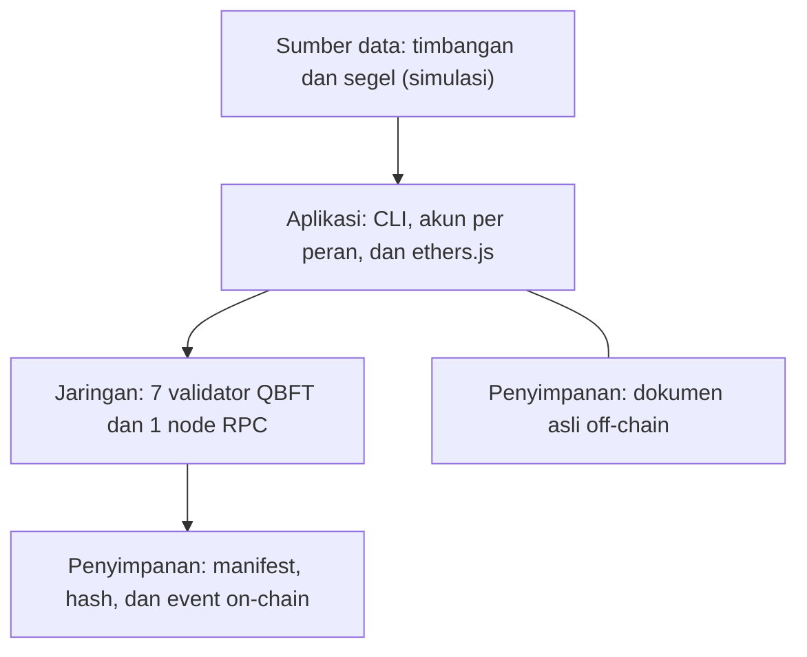

# ChainWaste

Prototipe pelacakan manifest limbah B3 untuk UAS Blockchain Technology,
Pradita University. ChainWaste mencatat perpindahan limbah dari pabrik
ke pengangkut dan pengolah. Auditor dapat memeriksa riwayat, menangani
selisih berat, dan membandingkan file manifest dengan hash yang tercatat.

## Arsitektur AF3



Basis data terpusat mengandalkan satu pengelola untuk mengendalikan pencatatan.
Model konsorsium AF3 membagi validasi blok di antara tujuh institusi dan memberi
setiap peserta jejak transaksi yang dapat diaudit. Besu menjalankan QBFT dengan
quorum lima tanda tangan dari tujuh validator. Node RPC menyajikan akses lokal
dan mereplikasi blok. Chain ID demo adalah `31370`, target EVM London, dan block
period 2 detik.

| Peran aplikasi | Tindakan |
| --- | --- |
| Regulator | Mendaftarkan dan mencabut peran, serta mengatur toleransi berat |
| Pabrik penghasil | Membuat manifest dan menetapkan pengangkut serta pengolah |
| Oracle simulasi | Mencatat berat pengambilan, hash segel, dan berat penerimaan |
| Pengangkut | Mengonfirmasi pengambilan manifest yang ditugaskan |
| Pengolah | Mengonfirmasi penerimaan dan menyimpan hash bukti pengolahan |
| Auditor | Menandai anomali dan menyelesaikan flag dengan hash catatan |

Manifest mengikuti `Created → InTransit → Received → Treated`. Kontrak
memvalidasi peran, alamat yang ditugaskan, urutan tindakan, dan berat.
Selisih di atas toleransi awal 5% menghasilkan flag yang memblokir pengolahan
sampai auditor menutupnya. CLI menghitung Keccak-256 dari byte file asli untuk
membandingkannya dengan hash on-chain.

`ValidatorGovernance` mencatat proposal penambahan atau pencabutan validator,
membatasi dua anggota per sektor, serta menetapkan lima suara untuk set awal
tujuh anggota. Pemilihan validator QBFT aktual masih mengikuti header blok
Besu. Dompet voting tata kelola terpisah dari kunci konsensus.

## Jalankan di Windows

Prasyarat yang dipakai pada pengujian adalah Node.js 24, npm, Git, serta
Docker Desktop dengan Linux containers. Dari PowerShell:

```powershell
git clone https://github.com/Keivysualize/chainwaste.git
Set-Location chainwaste
npm.cmd ci
npx.cmd hardhat test
node network/start.mjs
node network/deploy.mjs
node cli/chainwaste.mjs accounts
```

Tes sekaligus membangun artifact kontrak. Deployment menunggu blok bertambah
dan memeriksa tujuh validator, lalu mendaftarkan akun serta membuat manifest
seed. Port RPC lokal `127.0.0.1:8545` perlu tersedia.
Baca [panduan jaringan](network/README.md) untuk konfigurasi dan troubleshooting
serta [panduan CLI](cli/README.md) untuk skenario normal, anomali, dan verifikasi
dokumen. Simpan private key demo hanya di `network/generated/` pada mesin lokal.

## Hasil dan bukti

- **Hardhat:** 15 tes lulus, terdiri dari 10 tes ChainWaste dan 5 tes template.
- **Benchmark Besu:** 5 manifest sampai `Treated` melalui 30 transaksi.
  Rata-rata waktu panggilan hingga receipt terbaca 4.202 ms. Rata-rata
  `createManifest` 267.530 gas dengan biaya demo 0 wei.
- **Quorum:** blok bertambah dengan satu dan dua validator dihentikan,
  berhenti pada blok 222 saat tiga dihentikan, lalu pulih ke blok 223.
- **CLI di Besu:** manifest #7 selesai normal dan dokumen asli cocok.
  Manifest #8 memicu anomali berat, diblokir sampai auditor menutup flag,
  lalu mencapai `Treated`. Dokumen yang diubah menghasilkan `matches: false`.

Baca [hasil pengujian terperinci](docs/testing-results.md) untuk data gas,
latensi, dan rujukan transaksi. [Catatan kontribusi](CONTRIBUTIONS.md)
memisahkan pekerjaan yang sudah tercatat dari pekerjaan yang masih direncanakan.

## Batas prototipe

Timbangan dan segel disimulasikan, sehingga kualitas data awal masih bergantung
pada pihak yang mencatat. Hash membantu memeriksa perubahan file setelah
dicatat. RPC dibatasi ke loopback dengan peer statis di jaringan Docker.
Allowlist node/account dan rate limiting belum diterapkan. Uji validator
mengukur crash fault pada setup lokal. Status lisensi proyek belum ditetapkan.
